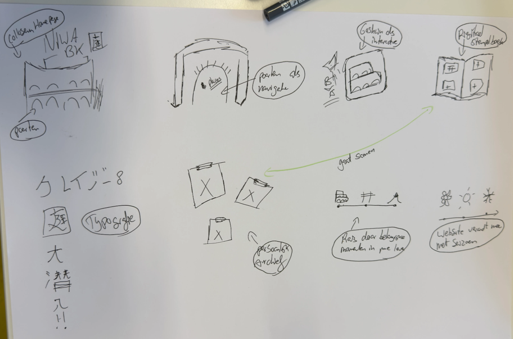

# de log van Batuhan Kutlu

## 9 nov kick-0ff
1. github is een shp. ik heb github gekozen omdat ik al eerder github heb gewerkt dus was dat voor mij de beste optie
2. ik heb niwa bk gekozen omdat niwa tuin is in het japans en bk mijn initialen zijn ik weet nog niet zeker welke richting ik op ga met de garden maar vond het wel dat ik de cultuur van japan ook erin terug wil verwerken omdat ik toen ik daar was erg was aangetrokken met hun kunst en cultuur
3. ik kan aanpassingen doen via vsc en ctrl s klikken om die op te slaan.

# de log van Batuhan Kutlu

## Opdracht 1
Door deze opdracht heb ik geleerd om websites niet alleen op uiterlijk te beoordelen, maar ook te kijken naar wat een website webby maakt. Ik heb geleerd om te letten op interactie, dynamiek, gebruik van het web en hoe een gebruiker de website ervaart. Ook heb ik gemerkt dat mijn eigen smaak invloed heeft op mijn mening. Dit helpt mij om beter na te denken over mijn eigen Digital Garden en welke interactieve elementen ik wil gebruiken.

[afbeelding]

## Opdracht 2 - Eigen verkenning

### Mijn Digital Garden: NIWA BMK

Voor mijn Digital Garden wil ik een persoonlijke website maken die NIWA BMK heet. *Niwa* betekent “tuin” in het Japans. Mijn website wordt geïnspireerd door het Colosseum in Rome. Ik wil dat de bezoeker in het midden van het Colosseum begint. Vanuit daar kan de bezoeker verschillende poorten ontdekken en openen.

Elke poort staat voor een ander deel van mij. Op deze manier kan ik mijn interesses, herinneringen, projecten en toekomst laten zien.

### Wat wil ik maken?

Ik wil geen normale website maken waar je alleen door verschillende pagina’s klikt. Ik wil dat de bezoeker zelf dingen kan ontdekken.

In het Colosseum komen verschillende poorten. Achter elke poort staat een ander onderwerp.

De bezoeker kan zelf kiezen welke poort hij wil openen. Hierdoor kan iedereen de website op zijn eigen manier ontdekken.

### Webby dingen

Ik wil verschillende interactieve elementen gebruiken op mijn website, zoals:

- Klikbare poorten
- Hover-effecten
- Animaties
- Een interactieve omgeving
- Een digitale stempelkaart
- Verborgen informatie
- Scroll-effecten

### Mijn eigen content

Mijn website gaat vooral over **mijzelf**. Ik wil laten zien wie ik ben, wat ik leuk vind en wat ik leer.

Ik kan bijvoorbeeld mijn CMD-projecten laten zien en vertellen wat ik tijdens mijn studie heb geleerd. Ook wil ik onderwerpen toevoegen die ik interessant vind, zoals **Japanse cultuur, de geschiedenis van Rome en muziek**.

De stijl van mijn website wordt **rustig, persoonlijk en een beetje mysterieus**. Ik wil dat de website netjes en classy aanvoelt.

Wat ik vooral goed vind aan mijn idee, is dat de poorten verschillende kanten van mij kunnen laten zien. De bezoeker ontdekt steeds een nieuw stukje van mijn verhaal.

### Goshuin

Ik wil ook inspiratie gebruiken uit de Japanse **Goshuin**. Dit zijn speciale stempels die mensen kunnen verzamelen bij tempels en heiligdommen in Japan.

Ik wil dit idee gebruiken voor mijn Digital Garden. Wanneer iemand een poort ontdekt, kan die persoon een **digitale stempel** verzamelen.

Zo ontstaat er uiteindelijk een persoonlijke verzameling van stempels.

### Content van anderen

Voor sommige informatie wil ik bronnen van anderen gebruiken. Bijvoorbeeld voor informatie over het Colosseum en de geschiedenis van Rome.

Voor afbeeldingen wil ik vooral eigen afbeeldingen gebruiken omdat ik zelf naar deze plekken ben gereisd.

Op deze manier blijft de website vooral mijn eigen verhaal.

### Hoe kan je de website ervaren?

Ik wil dat de bezoeker niet alleen tekst leest, maar de website ook echt ervaart.

De bezoeker begint in het Colosseum. Vanuit daar kan hij verschillende poorten bekijken en openen.

Het verzamelen van de stempels geeft de bezoeker een reden om verschillende onderdelen van mijn website te bekijken. Hierdoor wordt de website niet alleen een interactieve ervaring.

### Het doel

Het doel van NIWA BK is om mensen op een leuke en persoonlijke manier kennis te laten maken met mij.

In plaats van alleen te vertellen wie ik ben, wil ik dat mensen mijn website zelf ontdekken.

Het Colosseum is hierbij mijn wereld. De verschillende poorten laten verschillende kanten van mij zien.

## Di: Practicum Light & Dark theme (Sanne)

Tijdens dit practicum heb ik geleerd hoe ik met CSS custom properties een light en dark mode kan maken. Ik heb geleerd dat je kleuren en andere onderdelen van je design één keer kunt instellen en daarna op meerdere plekken kunt gebruiken.

Ook heb ik geleerd hoe color-scheme, prefers-color-scheme en light-dark() werken. Hiermee kan een website automatisch reageren op de voorkeur van de gebruiker.

Daarnaast heb ik geleerd dat je een website ook een **toggle** kunt geven, zodat de bezoeker zelf kan kiezen tussen licht, donker of automatisch. Ik vind dit handig omdat je hiermee de website beter kunt aanpassen aan de gebruiker.

Wat ik vooral uit het practicum heb gehaald, is dat custom properties ervoor zorgen dat je CSS overzichtelijker wordt. Als je bijvoorbeeld een kleur wilt veranderen, hoef je dit maar op één plek aan te passen. Dit kan ik later ook gebruiken voor mijn eigen Digital Garden NIWA BK, bijvoorbeeld voor verschillende thema’s en kleuren.

## Presenteren NIWA BK

**Wat is voor jou de essentie van wat je hebt gepresenteerd?**

De essentie van mijn presentatie is mijn eigen verhaal en de dingen die mij inspireren. Vooral de combinatie van Rome, Japan, cultuur en design past bij mij. Ik wil deze interesses samenbrengen in één persoonlijke Digital Garden.

**Heeft ‘de ander’ een aanvulling op je onderwerp?**

Een goede aanvulling is om meer persoonlijke herinneringen, foto's en eigen projecten toe te voegen. Hierdoor laat ik niet alleen zien wat ik interessant vind, maar ook wie ik ben en wat ik heb meegemaakt.

**Wat is het karakter, de uitstraling en het gevoel?**

Ik wil een sfeer creëren die rustig, uniek en klassiek voelt. De bezoeker moet het gevoel krijgen dat hij een wereld binnenkomt waarin hij zelf dingen kan ontdekken.

**Welke inspiratie haal je uit de afbeeldingen?**

Ik haal inspiratie uit Romeinse bogen en architectuur, maar ook uit Japanse patronen, stempels en traditionele vormen. Materialen zoals steen en hout geven mij inspiratie voor de uitstraling van NIWA BK.

# Feedback crazy 8 – NIWA BMK

**1. Wat zijn de beste ideeën en waarom?**

Het Colosseum als homepage en de poorten als navigatie zijn de sterkste ideeën. Ze zijn duidelijk en passen goed bij mijn concept. De Goshuin stempels maken het persoonlijker en unieker kwa interactie.

**2. Zijn de uitgangspunten terug te zien?**

Ja. De Romeinse stijl is te zien in het Colosseum, de bogen en de stijl van de schets. De Japanse komt terug in de Goshuin stempels en de speelse typografie.

**3. Is het online te vertalen?**

Ja. De poorten kunnen klikbare onderdelen worden. De kleuren kunnen crème, zand, bruin en rood zijn. De typografie kan klassiek worden gecombineerd met een speelser lettertype.

**4. Is het expressief en uitdagend?**

Ja. Ik kan werken met animaties waarbij poorten openen, stempels verschijnen en pagina's vloeiend overgaan. Hiermee kan ik nieuwe CSS en JavaScript technieken leren.
