# De log van Batuhan Kutlu

## 9 nov kick-0ff
1. github is een shp. ik heb github gekozen omdat ik al eerder github heb gewerkt dus was dat voor mij de beste optie
2. ik heb niwa bk gekozen omdat niwa tuin is in het japans en bk mijn initialen zijn ik weet nog niet zeker welke richting ik op ga met de garden maar vond het wel dat ik de cultuur van japan ook erin terug wil verwerken omdat ik toen ik daar was erg was aangetrokken met hun kunst en cultuur
3. ik kan aanpassingen doen via vsc en ctrl s klikken om die op te slaan.

## Opdracht 1
Door deze opdracht heb ik geleerd om websites niet alleen op uiterlijk te beoordelen, maar ook te kijken naar wat een website webby maakt. Ik heb geleerd om te letten op interactie, dynamiek, gebruik van het web en hoe een gebruiker de website ervaart. Ook heb ik gemerkt dat mijn eigen smaak invloed heeft op mijn mening. Dit helpt mij om beter na te denken over mijn eigen Digital Garden en welke interactieve elementen ik wil gebruiken.

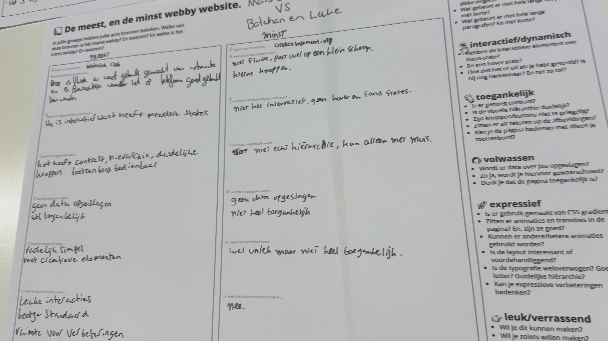
In duos besproken en beoordeeld a.d.h.v het blad

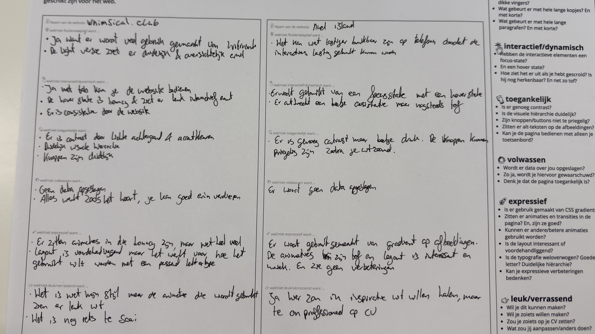
In groepjes samen besproken welke van de 4 websites het meeste webby en minst webby is.

## Opdracht 2 - Eigen verkenning

**Mijn Digital Garden: NIWA BMK****

Voor mijn Digital Garden wil ik een persoonlijke website maken die NIWA BMK heet. *Niwa* betekent “tuin” in het Japans. Mijn website wordt geïnspireerd door het Colosseum in Rome. Ik wil dat de bezoeker in het midden van het Colosseum begint. Vanuit daar kan de bezoeker verschillende poorten ontdekken en openen.

Elke poort staat voor een ander deel van mij. Op deze manier kan ik mijn interesses, herinneringen, projecten en toekomst laten zien.

 **Wat wil ik maken?**

Ik wil geen normale website maken waar je alleen door verschillende pagina’s klikt. Ik wil dat de bezoeker zelf dingen kan ontdekken.

In het Colosseum komen verschillende poorten. Achter elke poort staat een ander onderwerp.

De bezoeker kan zelf kiezen welke poort hij wil openen. Hierdoor kan iedereen de website op zijn eigen manier ontdekken.

**Webby dingen**

Ik wil verschillende interactieve elementen gebruiken op mijn website, zoals:

- Klikbare poorten
- Hover-effecten
- Animaties
- Een interactieve omgeving
- Een digitale stempelkaart
- Verborgen informatie
- Scroll-effecten

**Mijn eigen content**

Mijn website gaat vooral over mijzelf. Ik wil laten zien wie ik ben, wat ik leuk vind en wat ik leer.

Ik kan bijvoorbeeld mijn CMD-projecten laten zien en vertellen wat ik tijdens mijn studie heb geleerd. Ook wil ik onderwerpen toevoegen die ik interessant vind, zoals **Japanse cultuur, de geschiedenis van Rome en muziek.

De stijl van mijn website wordt rustig, persoonlijk en een beetje mysterieus. Ik wil dat de website netjes en classy aanvoelt.

Wat ik vooral goed vind aan mijn idee, is dat de poorten verschillende kanten van mij kunnen laten zien. De bezoeker ontdekt steeds een nieuw stukje van mijn verhaal.

**Goshuin**

Ik wil ook inspiratie gebruiken uit de Japanse Goshuin. Dit zijn speciale stempels die mensen kunnen verzamelen bij tempels en heiligdommen in Japan.

Ik wil dit idee gebruiken voor mijn Digital Garden. Wanneer iemand een poort ontdekt, kan die persoon een digitale stempel verzamelen.

Zo ontstaat er uiteindelijk een persoonlijke verzameling van stempels.

**Content van anderen**

Voor sommige informatie wil ik bronnen van anderen gebruiken. Bijvoorbeeld voor informatie over het Colosseum en de geschiedenis van Rome.

Voor afbeeldingen wil ik vooral eigen afbeeldingen gebruiken omdat ik zelf naar deze plekken ben gereisd.

Op deze manier blijft de website vooral mijn eigen verhaal.

**Hoe kan je de website ervaren?**

Ik wil dat de bezoeker niet alleen tekst leest, maar de website ook echt ervaart.

De bezoeker begint in het Colosseum. Vanuit daar kan hij verschillende poorten bekijken en openen.

Het verzamelen van de stempels geeft de bezoeker een reden om verschillende onderdelen van mijn website te bekijken. Hierdoor wordt de website niet alleen een interactieve ervaring.

**Het doel**

Het doel van NIWA BK is om mensen op een leuke en persoonlijke manier kennis te laten maken met mij.

In plaats van alleen te vertellen wie ik ben, wil ik dat mensen mijn website zelf ontdekken.

Het Colosseum is hierbij mijn wereld. De verschillende poorten laten verschillende kanten van mij zien.

## Checkout 

**1. Wat is een Digital Garden?**

Een Digital Garden is een persoonlijke website die steeds kan groeien en veranderen. Het is anders dan een normale website omdat je ideeën en content op een vrije en interactieve manier kunt ontdekken.

**2. Wat maakt een website webby?**

Een website is webby als je gebruikmaakt van interactie, animaties, hover-effecten, links en scrollen. Ik vind websites vooral interessant als je zelf dingen kunt ontdekken.

**3. Mijn Digital Garden**

Mijn Digital Garden heet NIWA BMK. Ik maak een digitaal Colosseum waarin verschillende poorten verschillende kanten van mij laten zien. Met inspiratie uit de Japanse Goshuin kan de bezoeker digitale stempels verzamelen tijdens het ontdekken.

## Di: Practicum Light & Dark theme (Sanne)

Tijdens dit practicum heb ik geleerd hoe ik met CSS custom properties een light en dark mode kan maken. Ik heb geleerd dat je kleuren en andere onderdelen van je design één keer kunt instellen en daarna op meerdere plekken kunt gebruiken.

Ook heb ik geleerd hoe color-scheme, prefers-color-scheme en light-dark() werken. Hiermee kan een website automatisch reageren op de voorkeur van de gebruiker.

Daarnaast heb ik geleerd dat je een website ook een **toggle** kunt geven, zodat de bezoeker zelf kan kiezen tussen licht, donker of automatisch. Ik vind dit handig omdat je hiermee de website beter kunt aanpassen aan de gebruiker.

Wat ik vooral uit het practicum heb gehaald, is dat custom properties ervoor zorgen dat je CSS overzichtelijker wordt. Als je bijvoorbeeld een kleur wilt veranderen, hoef je dit maar op één plek aan te passen. Dit kan ik later ook gebruiken voor mijn eigen Digital Garden NIWA BK, bijvoorbeeld voor verschillende thema’s en kleuren.

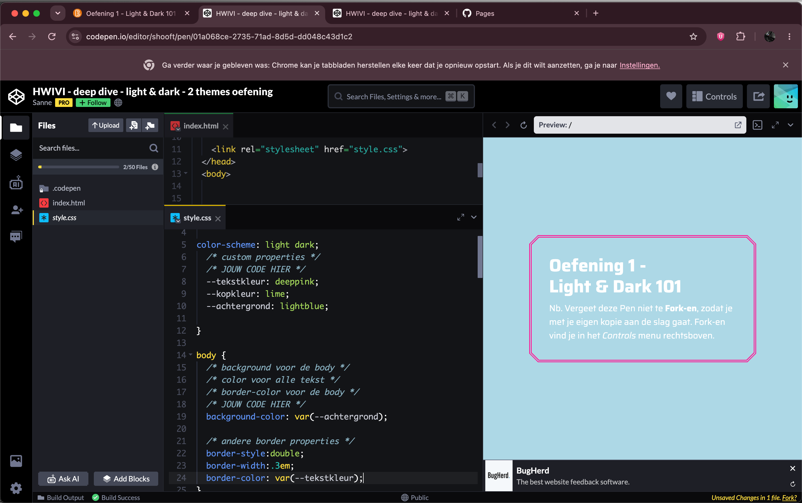
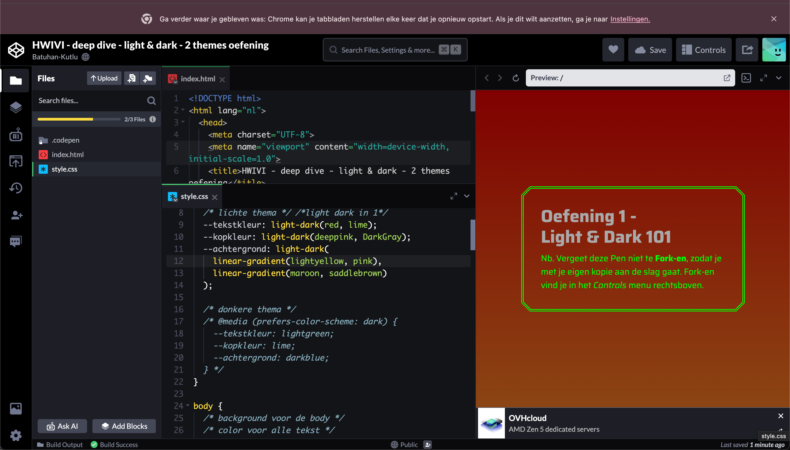
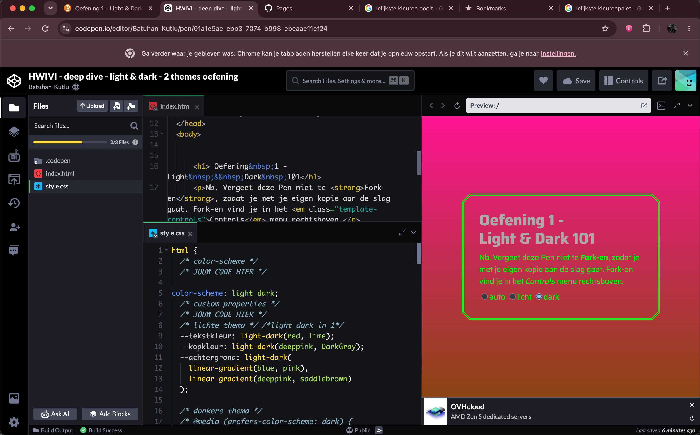

## Presenteren NIWA BK

**Wat is voor jou de essentie van wat je hebt gepresenteerd?**

De essentie van mijn presentatie is mijn eigen verhaal en de dingen die mij inspireren. Vooral de combinatie van Rome, Japan, cultuur en design past bij mij. Ik wil deze interesses samenbrengen in één persoonlijke Digital Garden.

**Heeft de ander een aanvulling op je onderwerp?**

Een goede aanvulling is om meer persoonlijke herinneringen, foto's en eigen projecten toe te voegen. Hierdoor laat ik niet alleen zien wat ik interessant vind, maar ook wie ik ben en wat ik heb meegemaakt.

**Wat is het karakter, de uitstraling en het gevoel?**

Ik wil een sfeer creëren die rustig, uniek en klassiek voelt. De bezoeker moet het gevoel krijgen dat hij een wereld binnenkomt waarin hij zelf dingen kan ontdekken.

**Welke inspiratie haal je uit de afbeeldingen?**

Ik haal inspiratie uit Romeinse bogen en architectuur, maar ook uit Japanse patronen, stempels en traditionele vormen. Materialen zoals steen en hout geven mij inspiratie voor de uitstraling van NIWA BK.

## Visual Research – NIWA BK

 Voor mijn Digital Garden NIWA BK ben ik begonnen met de sfeerwoorden betekenisvol en mystiek. Deze woorden passen bij mijn idee om mijn herinneringen, reizen, interesses en ontwikkeling op een persoonlijke manier te laten zien. 
 
 Tijdens mijn visual research heb ik gekeken naar mijn eigen foto's uit Rome en Japan en naar verschillende ontwerpen. Ik herken vooral bogen, poorten, klassieke vormen, papierstructuren, warme kleuren en verschillende typografieën. Van de vier gekozen afbeeldingen heb ik verschillende kenmerken meegenomen. 
 
 De Romeinse beelden geven mij een klassieke, rustige en luxe uitstraling. De Japanse posters geven juist een speelse en energieke uitstraling. De combinatie van creme, zandkleur, bruin en donkerrood, samen met klassieke en speelse typografie, past goed bij mijn idee. 
 
 Deze kenmerken wil ik meebrengen in mijn stijlguide. Ik wil hiermee een website maken die persoonlijk, rustig en mysterieus voelt. De bezoeker moet het gevoel krijgen dat hij door mijn wereld loopt en steeds iets nieuws ontdekt.
 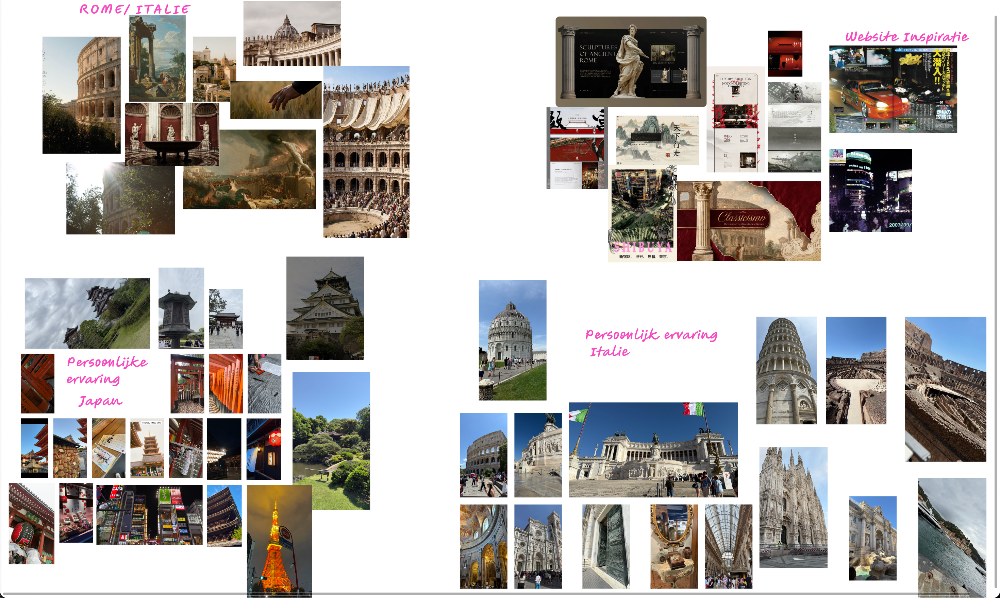
 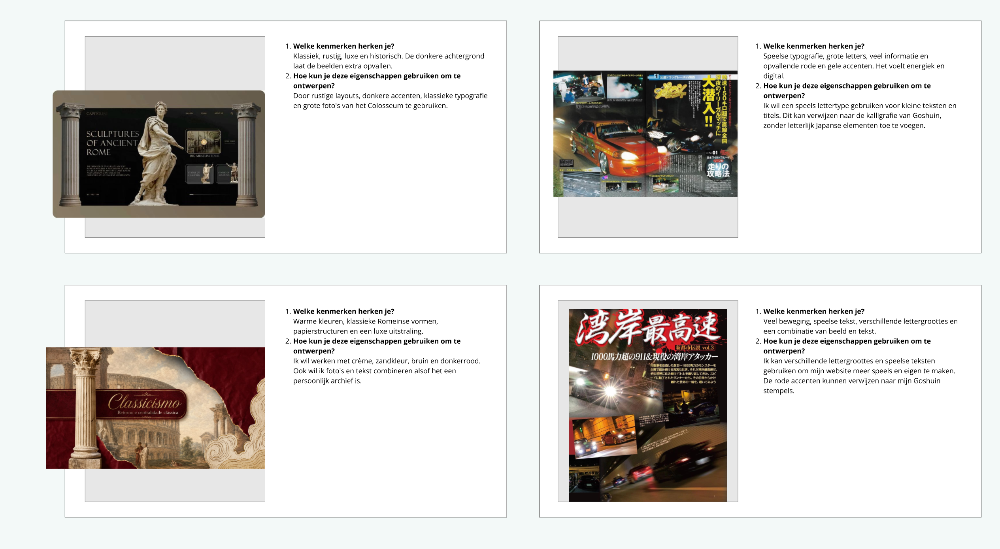

## Feedback crazy 8 – NIWA BMK

**1. Wat zijn de beste ideeën en waarom?**

Het Colosseum als homepage en de poorten als navigatie zijn de sterkste ideeën. Ze zijn duidelijk en passen goed bij mijn concept. De Goshuin stempels maken het persoonlijker en unieker kwa interactie.

**2. Zijn de uitgangspunten terug te zien?**

Ja. De Romeinse stijl is te zien in het Colosseum, de bogen en de stijl van de schets. De Japanse komt terug in de Goshuin stempels en de speelse typografie.

**3. Is het online te vertalen?**

Ja. De poorten kunnen klikbare onderdelen worden. De kleuren kunnen crème, zand, bruin en rood zijn. De typografie kan klassiek worden gecombineerd met een speelser lettertype.

**4. Is het expressief en uitdagend?**

Ja. Ik kan werken met animaties waarbij poorten openen, stempels verschijnen en pagina's vloeiend overgaan. Hiermee kan ik nieuwe CSS en JavaScript technieken leren.
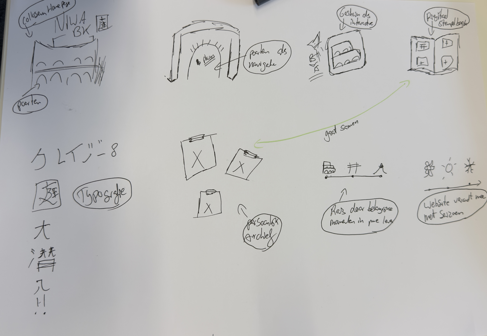

 ## Mogelijke kleurenpallet uit inspiratie van de collage

 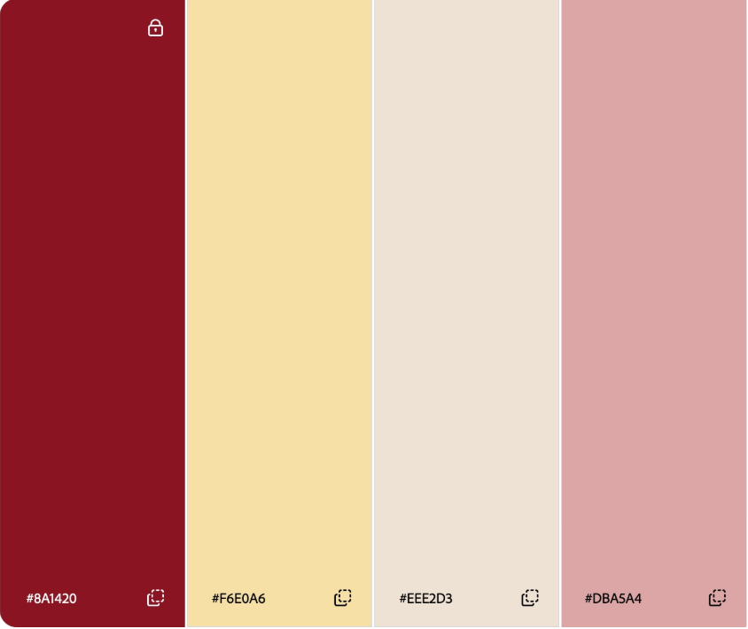

Mijn huidige kleurenpalet is gebaseerd op de vier gekozen afbeeldingen uit mijn visual research. Ik wil vooral werken met verschillende zachte creme en zandtinten, gecombineerd met 1 duidelijke accentkleur: bordeauxrood.

Omdat mijn drie thema’s verschillende stijlen combineren, wil ik met het kleurgebruik een goede overgang tussen deze stijlen creëren. De Romeinse stijl geeft een klassieke, rustige en luxe uitstraling, terwijl de Japanse inspirati* juist drukker, speelser en opvallender is door de typografie.

Door deze kleuren als basis te gebruiken en bordeauxrood als accentkleur in te zetten, wil ik deze twee stijlen met elkaar verbinden. Zo blijft de website rustig en classy, maar krijgt het ook genoeg contrast en karakter.

## Mogelijke typografie

Mogelijk typografie mix met kallografie van goshuin en de klassiekheid van de romeinse stijl.

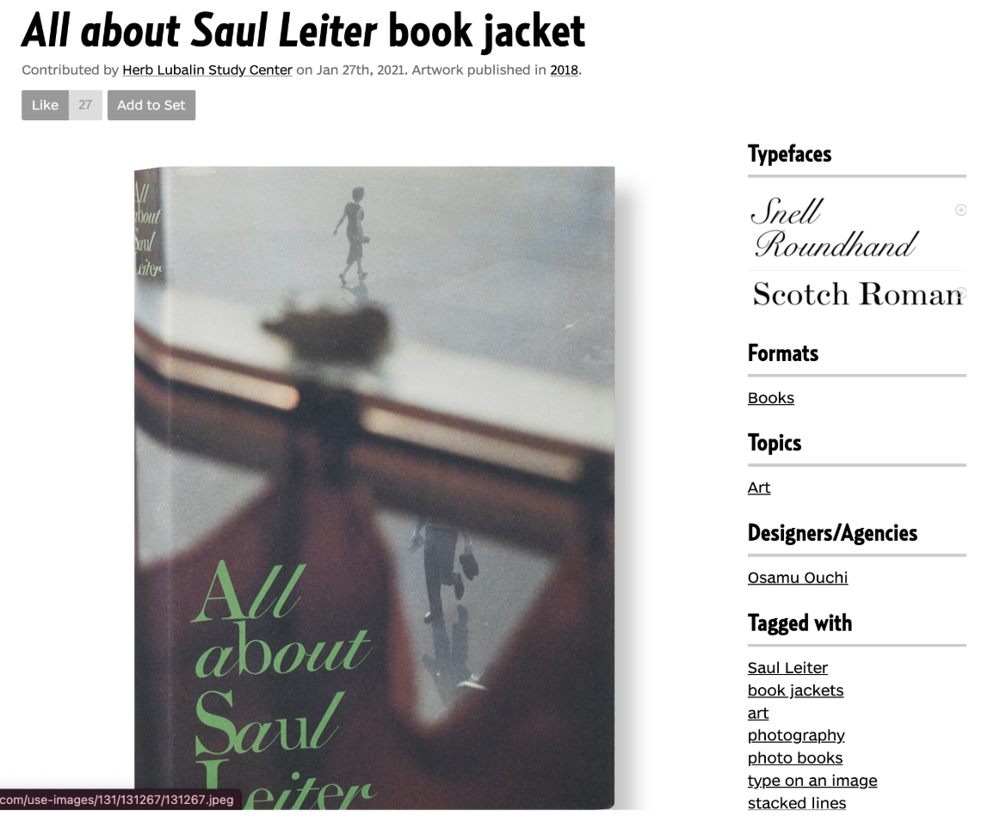
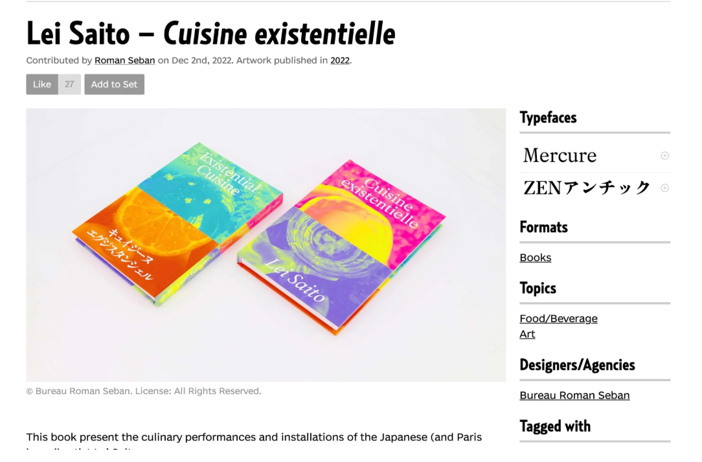
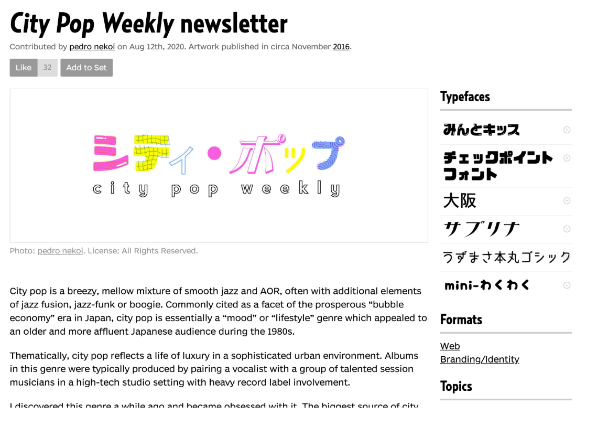

## Check-out

**1. Waar werkt Visual Research in 3 stappen naartoe?**

Visual Research helpt mij om van inspiratie naar een duidelijke stijl en een ontwerpidee te komen. Ik onderzoek eerst voorbeelden, daarna bepaal ik kenmerken zoals kleur, typografie en sfeer en gebruik ik deze voor mijn eigen concept.

**2. Waar gaat jouw Garden over?**

Mijn Digital Garden NIWA BMK gaat over mij, mijn herinneringen en interesses. Het Colosseum is de basis van mijn Garden en met Goshuin stempels wil ik mijn bezochte plekken en ontdekkingen op een interactieve manier verzamelen.

**3. Welk idee van de Crazy 8 wil je verder onderzoeken?**

Ik wil het idee van het Colosseum als startpunt verder onderzoeken. De verschillende poorten leiden naar onderdelen van mijn en bijvoorbeeld interesses.

## Wat ik uit het practicum heb gehaald

Tijdens dit practicum heb ik geleerd hoe je **kleuren en gradients in CSS** kunt gebruiken. Ik heb verschillende soorten gradients uitgeprobeerd, zoals linear-gradient(), radial-gradient() en conic-gradient().

Ook heb ik geleerd hoe je custom properties kunt gebruiken om kleuren in CSS overzichtelijk te maken. Daarna heb ik geprobeerd om een Turkse vlag na te maken met CSS. Het lukte mij om de maan te maken, maar de rest van de vlag kreeg ik nog niet goed voor elkaar.

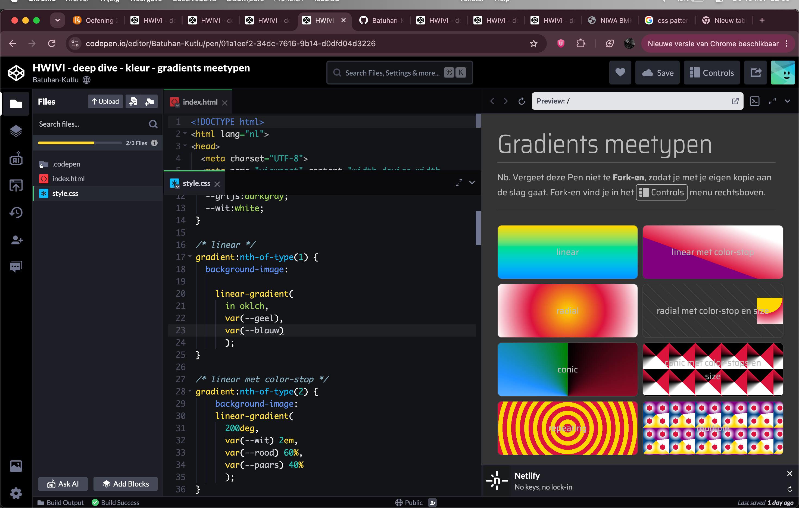
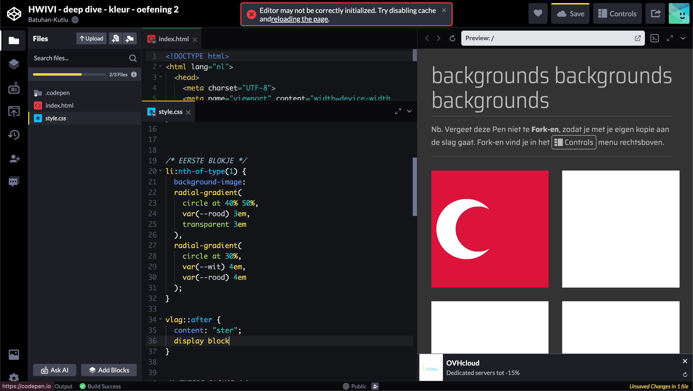

## Mobile schetsen

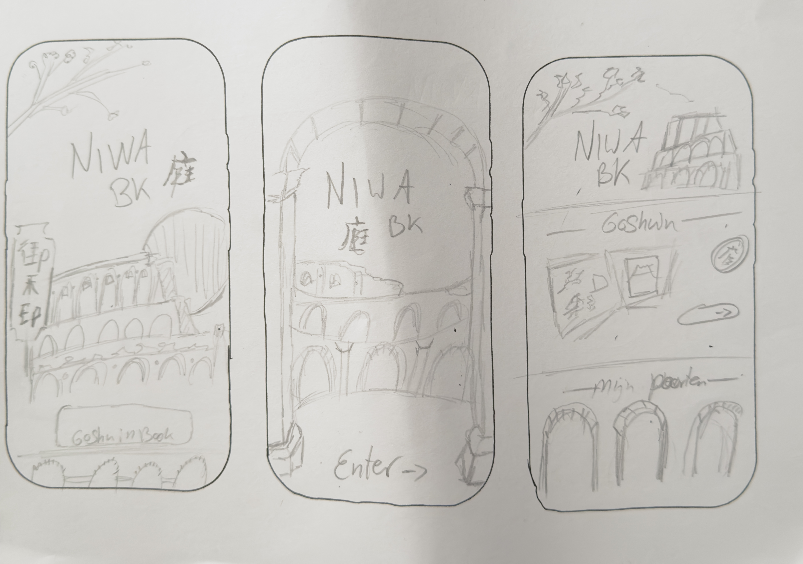 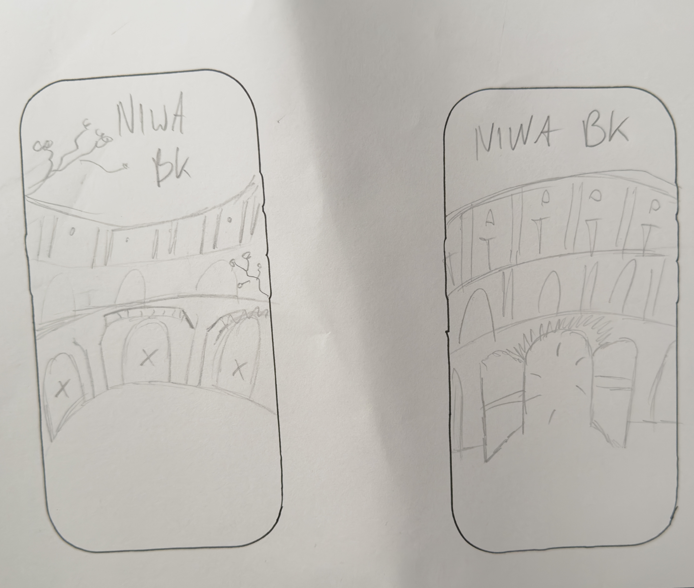

## Opdracht 12 – Bespreken huiswerk

**1. Zijn mijn schetsen Webby genoeg?**

Ik vind mijn schetsen Webby genoeg, omdat ik meerdere interactieve onderdelen heb bedacht. De bezoeker kan bijvoorbeeld op poorten klikken, door projecten bladeren en Goshuin-stempels verzamelen. Ook heb ik nagedacht over hover-effecten, animaties en scrollen.

**2. Hoe kan ik mijn ontwerp opbouwen in HTML en CSS?**

Ik kan mijn website opdelen in verschillende onderdelen, zoals Hero, Over mij, Mijn werelden, Projecten, Reis & Inspiratie en Contact. Deze onderdelen kan ik met HTML onder elkaar zetten. Met CSS kan ik daarna de layout, kleuren, afbeeldingen en responsive gedrag maken.

Mijn vijf poorten kan ik bijvoorbeeld als losse elementen binnen één onderdeel maken. Op mobiel komen ze onder elkaar te staan en op grotere schermen kunnen ze naast elkaar komen.

**3. Wat vind ik lastig?**

Ik vind vooral de **interactie van de poorten en Goshuin-stempels** lastig. Ik wil dat er iets gebeurt wanneer de bezoeker op een poort klikt. Ook moet ik ervoor zorgen dat mijn ontwerp op verschillende schermformaten goed blijft werken.

**4. Mijn definitieve bouwplan**

Mijn basis wordt een mobile-first onepager. Ik begin met de HTML-structuur en bouw daarna de layout met CSS. Ik wil eerst de belangrijkste onderdelen maken en daarna de interacties toevoegen. De Colosseum, poorten en Goshuin blijven de belangrijkste elementen van NIWA BK.

## Opdracht 13 & 14 – Van schets naar HTML

Van schermschets naar HTML
Ik ben begonnen met mijn schermschets van de Digital Garden. Eerst heb ik gekeken welke onderdelen er op mijn scherm staan en wat deze onderdelen betekenen. Daarna heb ik deze onderdelen vertaald naar HTML-elementen.

Tijdens het maken heb ik ook tips gekregen van de hulpstudenten. Zij adviseerden mij om mijn onderdelen goed op te delen en alles wat bij elkaar hoort in (section) elementen te zetten. Hierdoor werd mijn HTML overzichtelijker en kon ik mijn pagina beter structureren.

Voor de hero heb ik gekeken naar de belangrijkste onderdelen van mijn ontwerp: het Colosseum, de Sakura, de titel NIWA BK, de tekst en de link. De afbeeldingen heb ik met (img) toegevoegd. De titel heb ik als (h1) gebruikt, de tekst als (p) en “Ontdek mijn wereld” als (a).

Daarna heb ik het Goshuin-gedeelte gemaakt. Hiervoor heb ik een (section) gebruikt met een (h2), een (p), een afbeelding en een link naar de Goshuin-pagina.

Voor Mijn Werelden heb ik meerdere onderdelen die bij elkaar horen bij elkaar gezet. Hierbij heb ik handige tips gekregen over het maken van mijn list. Ik heb hiervoor een(nav) gebruikt met een (ul) en meerdere (li) elementen. In deze lijst staan mijn verschillende werelden, zoals Design, Interesses, Projecten, Reizen en Toekomst. Iedere wereld is een link naar een eigen pagina.

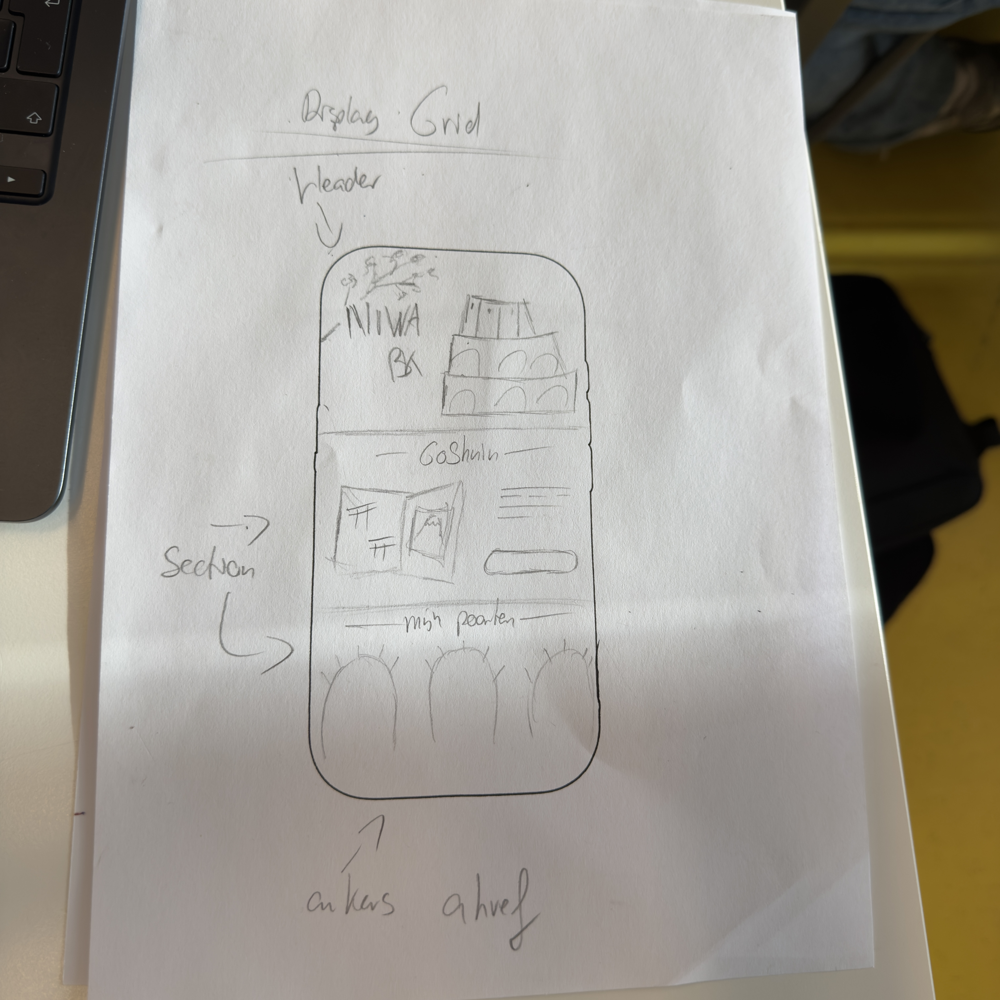

## Check out

Ik kreeg feedback dat er goed is nagedacht over het grote verschil tussen de twee stijlen. De dynamiek tussen de Romeinse en Japanse stijl is slim gedempt door mijn gekozen kleurenpalet. Ook kreeg ik tips over hoe ik het beste kan beginnen met het maken van mijn HTML.

## Opdracht 18 contrast

Voor deze opdracht heb ik mijn mobiele schermschets van mijn Digital Garden laten bekijken door een klasgenoot. Ik kreeg vooral positieve feedback op mijn ontwerp. Een idee dat ik erbij kreeg, was om het Goshuin-boekje verder te laten uitklappen. Hierdoor kan de bezoeker meer van het boekje zien en kan de tekst in het boekje zelf komen te staan. Dit past goed bij het idee van mijn digitale Goshuin-boekje en maakt de interactie duidelijker en interessanter. Verder kreeg ik positieve feedback op de opbouw en het ontwerp.

## Opdracht 19 & 20

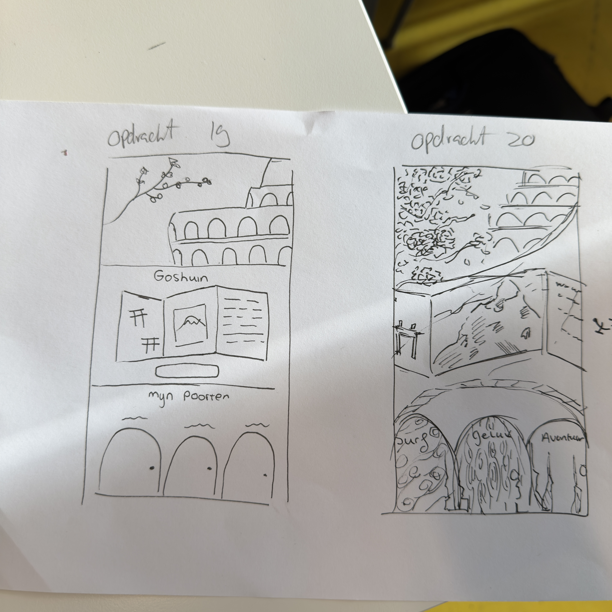

## Van HTML naar CSS

Nadat ik mijn HTML had gemaakt, ben ik begonnen met het vormgeven van mijn Digital Garden met CSS. Ik heb eerst mijn CSS variabelen aangemaakt voor de kleuren en de ruimte. Hierdoor kan ik dezelfde kleuren op verschillende plekken gebruiken zonder steeds de kleurcode opnieuw te schrijven.

Daarna heb ik de verschillende onderdelen van mijn website gestyled, zoals de header, teksten, knoppen, sections en footer. Voor mijn hero heb ik vooral gekeken naar de positie van de afbeeldingen. Ik wilde het Colosseum aan de rechterkant en de Sakura aan de linkerkant van mijn tekst plaatsen. Hiervoor heb ik position: absolute gebruikt en met right, left, top en width de afbeeldingen op de juiste plek gezet.

Ik heb hierbij opnieuw hulp en tips gekregen van de hulpstudenten. Zij hebben mij geholpen met het positioneren van de afbeeldingen en met het begrijpen en toepassen van media queries. Ook kreeg ik verschillende losse tips over mijn CSS en hoe ik bepaalde onderdelen beter kon aanpassen.

## Tot nu toe

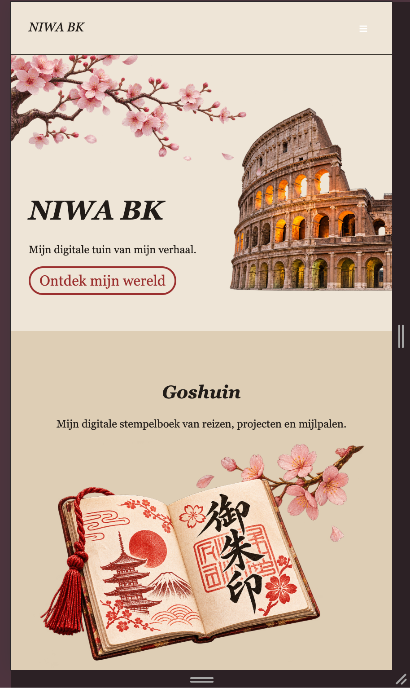
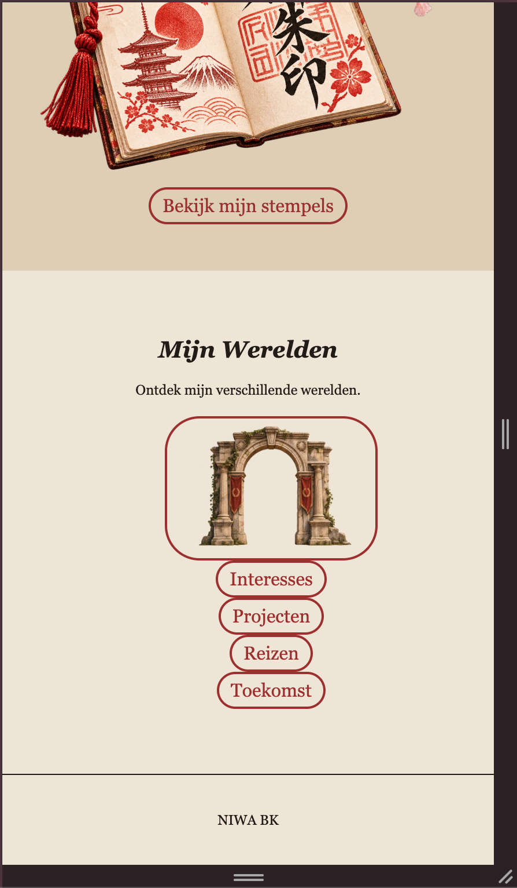

## Bronnen

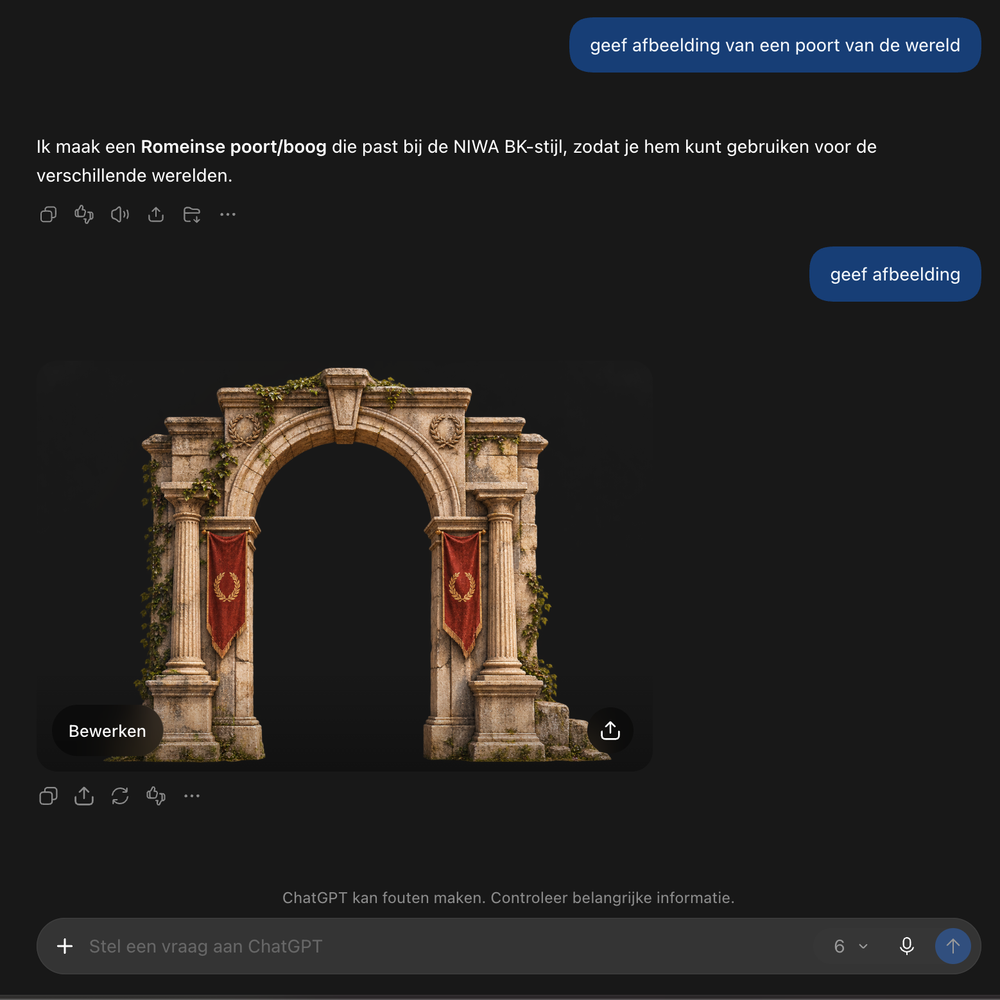
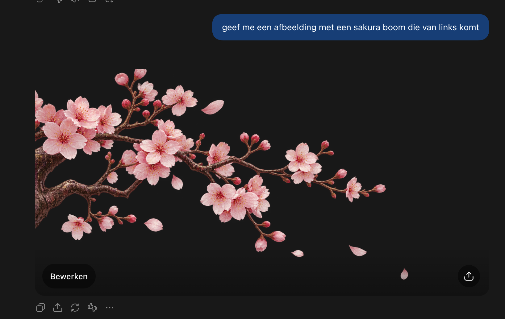
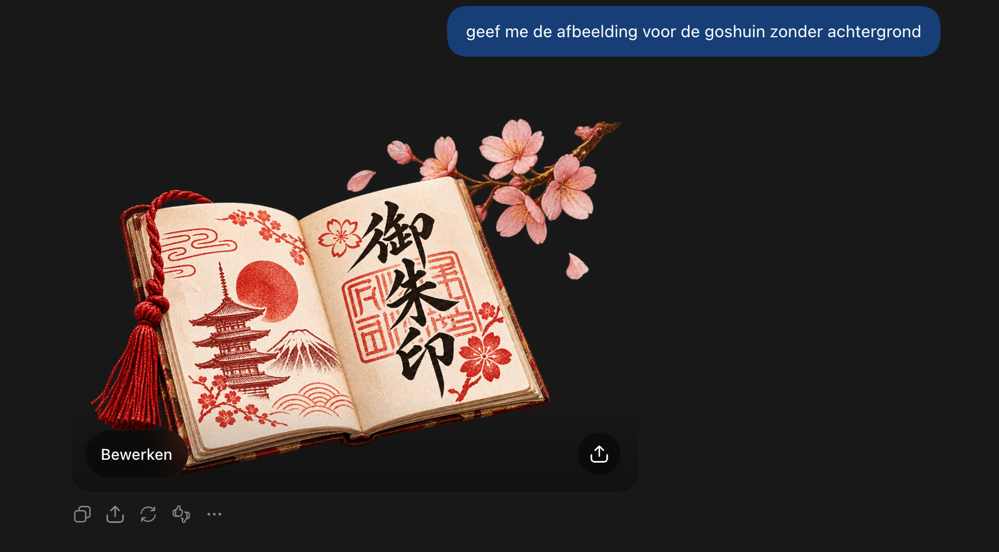

Tijdelijke afbeeldingen!

